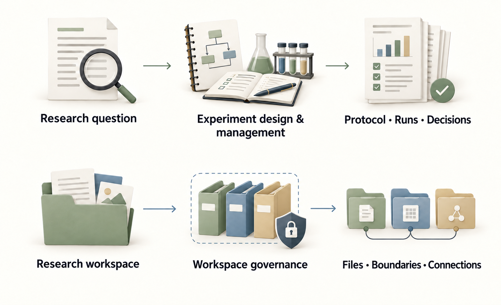

<div align="center">

<h1>Research Workflow Skills</h1>
<p>Design reproducible experiments. Keep research workspaces organized.</p>
<p><a href="https://github.com/DELONG-L/Research-Workflow-Skills/actions/workflows/validate.yml"></a> <a href="LICENSE"></a></p>
<p><a href="#choose-a-skill"><strong>Choose a skill</strong></a> · <a href="docs/guide.md">User guide</a> · <a href="README.zh-CN.md">简体中文</a></p>

</div>

## Choose a skill

| You need to | Use | Typical output |
|---|---|---|
| Formalize and manage an experiment | [experiment-design-management](experiment-design-management/SKILL.md) | A protocol, run records, analysis plan, and evidence for the next decision |
| Organize a research workspace | [research-workspace-governance](research-workspace-governance/SKILL.md) | A workspace contract, explicit file boundaries, and optional paper/HPC connections |

The skills are independently installable. Experiment management owns scientific records and lifecycle decisions; workspace governance owns paths and repository boundaries.

[](docs/illustrations/research-workflows-en.png)

## Get started

Ask Codex:

```text
Install the two skills from https://github.com/DELONG-L/Research-Workflow-Skills:
experiment-design-management and research-workspace-governance.
Preserve existing installations and validate the installed skills.
```

Or use the [manual installation guide](docs/guide.md#manual-installation). Both skills support automatic discovery and explicit invocation:

```text
Use $experiment-design-management to formalize this research question
into a reproducible experiment plan.

Use $research-workspace-governance to organize this local research workspace.
```

## Adapt to your project

Start with a local workspace. A separate paper repository, Overleaf Git, and HPC execution mirror are optional extensions. Neither skill grants permission for external submission, remote changes, or destructive cleanup.

Open-ended ideation does not require a managed experiment lifecycle. Use the full workflow when you want explicit protocols, records, and decisions.

## Learn more

[Installation, validation, and versions](docs/guide.md) · [Workspace contract](research-workspace-governance/references/project-workspace-contract.md) · [MIT licence](LICENSE)
