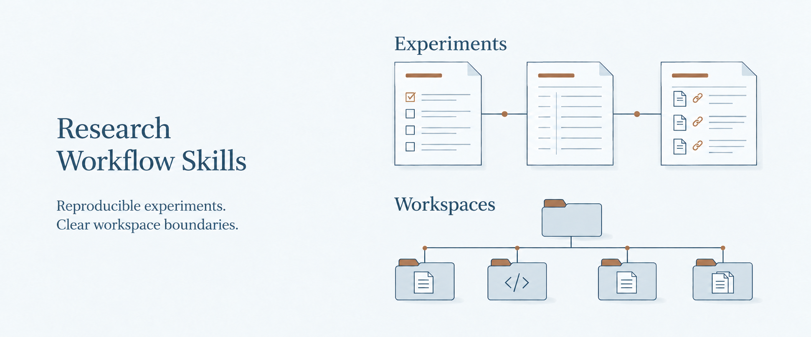

# Research Workflow Skills

Two Codex skills to plan reproducible experiments, preserve research records, and organize research workspaces.

**[Choose a skill](#choose)** · [Install](#start) · [Guide](docs/guide.md) · [简体中文](README.zh-CN.md)

<a href="#choose"></a>

[](https://github.com/DELONG-L/Research-Workflow-Skills/actions/workflows/validate.yml) [](LICENSE)

<a id="choose"></a>
## Choose a skill

Use either skill independently, or combine them. Experiment management owns scientific records and lifecycle decisions; workspace governance owns paths and repository boundaries.

### Design and manage an experiment

Define the question and comparisons, plan the analysis before execution, and retain the records behind the result.

**Outputs:** a protocol and analysis plan, run and deviation records, and a results record with limitations and a reproduction path.

[experiment-design-management](experiment-design-management/SKILL.md)

<details>
<summary><strong>See the experiment records</strong></summary>

The default [experiment record structure](experiment-design-management/references/experiment-records.md):

```text
experiments/EXP-YYYY-NNN/
├── design.md
├── protocol.md
├── analysis-plan.md
├── data-manifest.yml
├── execution-log.md
├── deviations.md
└── results.md
```

A managed workspace can declare a different experiment root. An additional `execution-spec.md` is optional when remote or multi-stage work needs an operational handoff.

</details>

### Organize a research workspace

Keep the local research repository canonical, with explicit locations for source code and experiment records. Define separate repository and synchronization boundaries when you add paper or HPC connections.

**Outputs:** `PROJECT-WORKSPACE.md`, declared source and experiment paths, and optional paper/HPC links.

[research-workspace-governance](research-workspace-governance/SKILL.md)

<details>
<summary><strong>See a local workspace</strong></summary>

A local-only [workspace](research-workspace-governance/references/project-workspace-contract.md) can start with:

```text
project/
├── PROJECT-WORKSPACE.md
├── experiments/
├── src/
├── configs/
└── scripts/
```

The contract declares the actual paths. A separate paper repository and an HPC execution mirror are optional extensions.

</details>

<a id="start"></a>
## Get started

Ask Codex to install both skills:

```text
Install both skills from:
https://github.com/DELONG-L/Research-Workflow-Skills
- experiment-design-management
- research-workspace-governance
Preserve existing installations
and validate the installed skills.
```

To install only one, name only that skill. The [manual installation guide](docs/guide.md#manual-installation) covers copying the skill directories yourself.

Both skills support automatic discovery and explicit invocation:

**For an experiment**

```text
Use $experiment-design-management
to turn this research question
into a reproducible protocol
and analysis plan.
```

**For a workspace**

```text
Use $research-workspace-governance
to organize this local
research workspace.
```

<a id="scope"></a>
## Adapt to your project

Start locally. A separate paper repository, Overleaf Git, and an HPC execution mirror are optional. When HPC is configured, the local repository remains canonical and synchronization follows the declared file boundaries.

Keep open-ended ideation informal. Use experiment management when you want explicit protocols, execution records, and decisions. Workspace governance applies when you request a managed workspace or a valid contract already exists.

External submission, remote changes, and destructive cleanup still require your authorization.

---

[Installation, validation, and versions](docs/guide.md) · [Visual assets and sources](docs/visuals.md) · [MIT licence](LICENSE)
