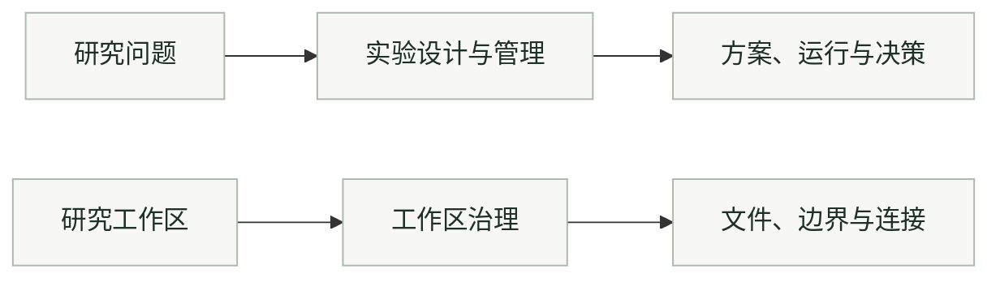

<div align="center">

<h1>Research Workflow Skills</h1>
<p>设计可复现的实验，组织边界清楚的研究工作区。</p>
<p><a href="https://github.com/DELONG-L/Research-Workflow-Skills/actions/workflows/validate.yml"></a> <a href="LICENSE"></a></p>
<p><a href="#选择技能"><strong>选择技能</strong></a> · <a href="docs/guide.zh-CN.md">使用指南</a> · <a href="README.md">English</a></p>

</div>

## 选择技能

| 当前需要 | 使用技能 | 典型输出 |
|---|---|---|
| 明确并管理实验 | [experiment-design-management](experiment-design-management/SKILL.md) | 实验方案、运行记录、分析计划与下一步决策依据 |
| 整理研究工作区 | [research-workspace-governance](research-workspace-governance/SKILL.md) | 工作区契约、文件边界，以及可选的论文仓库和 HPC 连接 |

两个技能可以分别安装。实验管理负责科学记录与阶段决策；工作区治理负责路径与仓库边界。



## 开始使用

可以让 Codex 安装：

```text
安装 https://github.com/DELONG-L/Research-Workflow-Skills 中的两个技能：
experiment-design-management 和 research-workspace-governance。
保留已有安装，并校验安装后的技能。
```

也可以按照[使用指南](docs/guide.zh-CN.md)手动安装。两个技能支持自动发现和显式调用：

```text
用 $experiment-design-management 把这个研究问题整理成可复现的实验计划。

用 $research-workspace-governance 整理这个本地研究工作区。
```

## 按项目需要选用

从本地工作区开始。独立论文仓库、Overleaf Git 和 HPC 执行镜像都是可选扩展。技能本身不授权对外投稿、远程修改或破坏性清理。

开放式想法讨论不必进入完整实验生命周期。需要明确的实验方案、记录和决策时，再采用管理流程。

## 继续了解

[安装、验证与版本](docs/guide.zh-CN.md) · [工作区契约](research-workspace-governance/references/project-workspace-contract.md) · [MIT 许可证](LICENSE)
