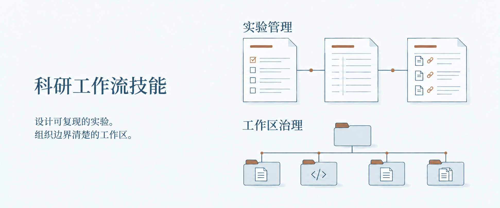

# Research Workflow Skills

两个 Codex 技能，帮助你规划与记录可复现的实验，组织边界清楚的研究工作区。

**[选择技能](#choose)** · [开始使用](#start) · [使用指南](docs/guide.zh-CN.md) · [English](README.md)

<a href="#choose"></a>

[](https://github.com/DELONG-L/Research-Workflow-Skills/actions/workflows/validate.yml) [](LICENSE)

<a id="choose"></a>
## 选择技能

两个技能可以独立使用，也可以配合使用。实验管理负责科学记录与阶段决策；工作区治理负责路径与仓库边界。

### 设计与管理实验

明确研究问题与比较条件，在执行前安排分析方法，并保留支持结果的实验记录。

**典型输出：** 实验方案与分析计划、运行记录与方案偏离记录，以及说明局限和复现路径的结果记录。

[experiment-design-management](experiment-design-management/SKILL.md)

<details>
<summary><strong>查看实验记录结构</strong></summary>

默认的[实验记录结构](experiment-design-management/references/experiment-records.md)：

```text
experiments/EXP-YYYY-NNN/
├── design.md
├── protocol.md
├── analysis-plan.md
├── data-manifest.yml
├── execution-log.md
├── deviations.md
└── results.md
```

受管理的工作区可以指定其他实验根目录。远程或多阶段任务需要执行交接时，还可以按需增加 `execution-spec.md`。

</details>

### 组织研究工作区

以本地仓库为规范来源，明确代码与实验记录的位置。接入论文仓库或 HPC 时，再定义仓库与同步边界。

**典型输出：** `PROJECT-WORKSPACE.md`、明确的源码与实验路径，以及可选的论文仓库或 HPC 连接。

[research-workspace-governance](research-workspace-governance/SKILL.md)

<details>
<summary><strong>查看本地工作区结构</strong></summary>

仅在本地使用时，可以从这样的[工作区结构](research-workspace-governance/references/project-workspace-contract.md)开始：

```text
project/
├── PROJECT-WORKSPACE.md
├── experiments/
├── src/
├── configs/
└── scripts/
```

实际路径由工作区契约声明。独立论文仓库与 HPC 执行镜像都是可选扩展。

</details>

<a id="start"></a>
## 开始使用

可以让 Codex 安装两个技能：

```text
请从以下仓库安装两个技能：
https://github.com/DELONG-L/Research-Workflow-Skills
- experiment-design-management
- research-workspace-governance
保留已有安装，并校验安装后的技能。
```

只需要其中一个时，在请求中只保留对应名称。也可以按照[手动安装指南](docs/guide.zh-CN.md#手动安装)复制技能目录。

两个技能支持自动发现和显式调用：

**用于实验**

```text
用 $experiment-design-management
把这个研究问题整理成
可复现的实验方案与分析计划。
```

**用于工作区**

```text
用 $research-workspace-governance
整理这个本地研究工作区。
```

<a id="scope"></a>
## 按项目需要选用

从本地开始。独立论文仓库、Overleaf Git 与 HPC 执行镜像都是可选扩展。配置 HPC 后，本地仓库仍是规范来源，同步遵循已声明的文件边界。

开放式想法讨论可以保持轻量。需要明确的实验方案、执行记录和决策时，再使用实验管理。明确要求建立受管理的工作区，或已有有效工作区契约时，再应用工作区治理。

对外投稿、远程修改与破坏性清理仍需由你授权。

---

[安装、验证与版本](docs/guide.zh-CN.md) · [视觉资源与来源](docs/visuals.md) · [MIT](LICENSE)
